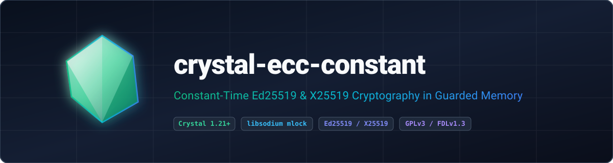

<p align="center">
  
</p>

<p align="center">
  <strong>Constant-time Ed25519 digital signatures and X25519 ECDH key agreement for Crystal backed by libsodium guarded memory and page protection.</strong>
</p>

<p align="center">
  <a href="https://gitlab.com/renich/crystal-ecc-constant/-/releases"></a>
  <a href="https://crystal-lang.org/">= 1.21.0" /></a>
  <a href="https://gitlab.com/renich/crystal-ecc-constant/-/pipelines"></a>
  <a href="https://gitlab.com/renich/crystal-ecc-constant"></a>
  <a href="https://github.com/crystal-ameba/ameba"></a>
  <a href="https://github.com/kdairatchi/flaw"></a>
</p>

<p align="center">
  <a href="https://renich.gitlab.io/crystal-ecc-constant/"></a>
  <a href="https://renich.gitlab.io/crystal-ecc-constant/technical/api/"></a>
  <a href="LICENSE"></a>
  <a href="https://liberapay.com/Renich/donate"></a>
</p>

> **GitLab Project Metadata**:
> - **Description**: Constant-time Ed25519 digital signatures and X25519 ECDH key agreement for Crystal backed by libsodium guarded memory and page protection.
> - **Topics and Tags**: `crystal`, `crystal-lang`, `cryptography`, `ed25519`, `x25519`, `ecdh`, `libsodium`, `constant-time`, `security`, `gplv3`

---

## Overview

**crystal-ecc-constant** is a constant-time Elliptic Curve Cryptography shard for Crystal binding directly to `libsodium` for Ed25519 and Ed25519ph digital signatures, X25519 ECDH key agreement, and BLAKE2b guarded subkey derivation with complete garbage collector secret isolation. All private keys, streaming hash states, KDF subkeys, and unconsumed shared secrets reside exclusively inside `sodium_malloc` guarded memory with `mlock` pinning, surrounding canary and guard pages, `sodium_mprotect_readonly` page locks, `Sync::Mutex` FFI synchronization, and deterministic `sodium_memzero` wiping.

### Key Highlights

1. **Guarded Memory & Hardware Page Protection**: Secret material (`SecureBuffer`, `PrivateKeyPointer`, `SharedSecret`, and `Ed25519PhStream`) is allocated via `sodium_malloc`, locked read-only via `sodium_mprotect_readonly` while at rest, and deterministically zeroized via `sodium_memzero` prior to `sodium_free`.
2. **Constant-Time Ed25519, Ed25519ph, X25519 & KDF Primitives**: Random keypair generation, deterministic 32-byte seed derivation, 64-byte detached Ed25519 signatures, multi-part pre-hashed `Ed25519ph` streaming signatures (`Ed25519PhStream`), Curve25519 ECDH key exchange with small-order point rejection, BLAKE2b subkey derivation (`Kdf.derive_subkey`), and `sodium_memcmp` constant-time equality.
3. **Thread-Safe Parallel Execution**: Synchronized across Crystal 1.21 `Fiber::ExecutionContext::Parallel` threads via `Sync::Mutex` and `Atomic(Bool)` double-checked initialization.
4. **Multi-Tier Documentation & Wycheproof Verification**: Validated against RFC 8032, RFC 7748, and Project Wycheproof edge-case vectors alongside a complete Sphinx technical, functional, business, ADR, D2 diagram, and Crystal API documentation suite.

---

## Installation

Add `crystal-ecc-constant` to your application's `shard.yml`:

```yaml
dependencies:
  crystal-ecc-constant:
    gitlab: renich/crystal-ecc-constant
    version: ~> 0.2.2
```

Then install the shard (ensure `libsodium-devel` is installed on your host):

```bash
shards install
```

---

## Usage

```crystal
require "crystal-ecc-constant"

# Initialize libsodium (thread-safe, idempotent, verifies major version >= 10)
Crystal::Ecc::Constant::Sodium.init

# Ed25519 Signing & Verification
keypair = Crystal::Ecc::Constant::Ed25519KeyPair.generate
begin
  message = "Strictly FIDO2 assertion payload".to_slice
  signature = keypair.sign(message)
  puts "Signature valid: #{keypair.verify(message, signature)}"

  # Multi-part Ed25519ph Streaming Signature in Guarded Memory
  signer = Crystal::Ecc::Constant::Ed25519PhStream.new
  signer.update("Chunk 1: ".to_slice).update("Chunk 2".to_slice)
  ph_sig = signer.final_sign(keypair)

  verifier = Crystal::Ecc::Constant::Ed25519PhStream.new
  verifier.update("Chunk 1: Chunk 2".to_slice)
  puts "Ed25519ph valid: #{verifier.final_verify(keypair.public_key, ph_sig)}"
ensure
  keypair.dispose
end

# Guarded BLAKE2b Subkey Derivation (crypto_kdf)
master_key = Crystal::Ecc::Constant::SecureBuffer.from_bytes(Random::Secure.random_bytes(32))
subkey = Crystal::Ecc::Constant::Kdf.derive_subkey(master_key, 1_u64, "ECC_KDF1", 32)
subkey.dispose
master_key.dispose

# X25519 ECDH Key Exchange (Block-Scoped Auto-Disposal)
alice = Crystal::Ecc::Constant::X25519KeyPair.generate
bob = Crystal::Ecc::Constant::X25519KeyPair.generate
begin
  alice.diffie_hellman(bob.public_key).consume do |alice_secret|
    bob.diffie_hellman(alice.public_key).consume do |bob_secret|
      matched = Crystal::Ecc::Constant::Sodium.constant_time_equal?(alice_secret, bob_secret)
      puts "Secrets match: #{matched}"
    end
  end
ensure
  alice.dispose
  bob.dispose
end
```

---

## Build System Targets

The repository includes a comprehensive, standard `GNUmakefile`:

| Target | Description |
| :--- | :--- |
| `make all` | Runs static analysis (`lint`), documentation linting (`doc-check`), and the test suite (`test`) |
| `make test` | Executes the spec test suite (`crystal spec`) |
| `make lint` | Runs `crystal tool format --check`, Ameba static analysis, and Flaw SAST security scanner |
| `make doc-check` | Lints all reStructuredText files using `crstlint` and `rstcheck` |
| `make check` | Aggregates `lint`, `doc-check`, and `test` |
| `make docs` | Generates Crystal API docs (`docs/technical/api`) and builds the Sphinx `dirhtml` portal (`docs/build/dirhtml`) |
| `make deps` | Installs Shards dependencies and builds `bin/ameba` and `bin/flaw` |
| `make clean` | Removes build artifacts and generated documentation |

---

## Documentation

Full architectural blueprints, functional specifications, and operational playbooks are maintained under [`docs/`](docs/index.rst):

| Guide | Scope & Highlights | Entry Point |
| :--- | :--- | :--- |
| **Business Context & Strategy** | Cryptographic security problem statement, ROI metrics, and personas. | [Business Specs](docs/business/spec.rst) |
| **Functional Specifications** | Requirements `[FUNC-001]`–`[FUNC-007]` and behavioral contracts. | [Functional Specs](docs/functional/spec.rst) |
| **Technical Architecture** | Specifications `[TECH-001]`–`[TECH-007]`, D2 architecture diagram, and threat model. | [Technical Specs](docs/technical/spec.rst) |
| **Release Playbook** | SemVer, Keep a Changelog, and GPG-signed GitLab release steps. | [Release Procedure](docs/technical/specs/release-procedure.rst) |
| **Architecture Decisions (ADRs)** | Immutable logs of architectural decisions and security trade-offs. | [ADR Index](docs/adrs/index.rst) |
| **Project Roadmap** | Dependency-tracked phased milestones, D2 roadmaps, and audit logs. | [Project Roadmap](docs/project/roadmap.rst) |
| **User Guides** | Installation, usage examples, and exception handling. | [User Manual](docs/user/index.rst) |
| **Crystal API Reference** | Complete interactive type hierarchy and method signatures. | [API Reference](https://renich.gitlab.io/crystal-ecc-constant/technical/api/) |

---

## Contributing & Code of Honor

All contributions must adhere to the [Universal Code of Honor](CODE_OF_HONOR.rst) and [Contributing Guidelines](CONTRIBUTING.rst).

---

## License

- **Software**: GNU General Public License v3.0 or later ([LICENSE](LICENSE)).
- **Documentation**: GNU Free Documentation License v1.3 or later ([LICENSE-DOCS](LICENSE-DOCS)).

Copyleft &copy; 2026 Rénich Bon Ćirić &lt;renich@evalinux.com&gt;.

---

## Support & Donations

If you find this shard useful and wish to support its ongoing development, please consider donating:

<p align="center">
  <a href="https://liberapay.com/Renich/donate">
    
  </a>
</p>
