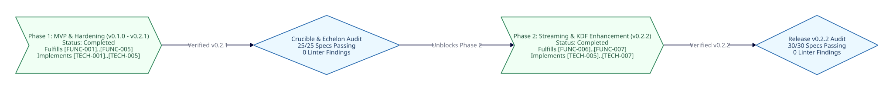

===============
Project Roadmap
===============

Overview
--------

This document defines the macro-level timeline, phase gating, and bidirectional requirement traceability for ``crystal-ecc-constant``. Every milestone and atomic task maps directly to functional requirements ``[FUNC-001]`` through ``[FUNC-007]`` and technical specifications ``[TECH-001]`` through ``[TECH-007]``.

Macro-Timeline Diagram
----------------------

Phase Summary
-------------

.. list-table::
   :widths: 25 15 15 22 23
   :header-rows: 1

   * - Phase
     - Target Version
     - Status
     - Functional Scope
     - Technical Scope
   * - :doc:`Phase 1: MVP <roadmaps/phase-1-mvp>`
     - ``v0.2.1``
     - Completed
     - ``[FUNC-001]``..``[FUNC-005]``
     - ``[TECH-001]``..``[TECH-005]``
   * - :doc:`Phase 2: Enhancement <roadmaps/phase-2-enhancement>`
     - ``v0.3.0``
     - Planned
     - ``[FUNC-006]``..``[FUNC-007]``
     - ``[TECH-005]``..``[TECH-007]``

* :doc:`Phase 1: MVP <roadmaps/phase-1-mvp>` (``v0.2.1`` — Completed): Delivered guarded memory secret isolation (``SecureBuffer`` and ``PrivateKeyPointer``), constant-time Ed25519 digital signatures, constant-time X25519 ECDH key agreement with single-use ``SharedSecret#consume`` auto-disposal, ``sodium_memcmp`` constant-time equality, ``Sync::Mutex`` FFI concurrency safety across ``Fiber::ExecutionContext::Parallel``, and the Sphinx and Crystal API documentation suite.
* :doc:`Phase 2: Enhancement <roadmaps/phase-2-enhancement>` (``v0.3.0`` — Planned): Expands cryptographic capabilities with RFC 8032 Section 5.1 pre-hashed ``Ed25519ph`` streaming signatures in guarded memory (``crypto_sign_ed25519ph_state``), BLAKE2b guarded subkey derivation (``crypto_kdf_derive_from_key``), and automated RFC 8032, RFC 7748, and Project Wycheproof edge-case vector verification.

.. toctree::
   :maxdepth: 1
   :caption: Roadmap Phases

   roadmaps/phase-1-mvp
   roadmaps/phase-2-enhancement
   audits/index
