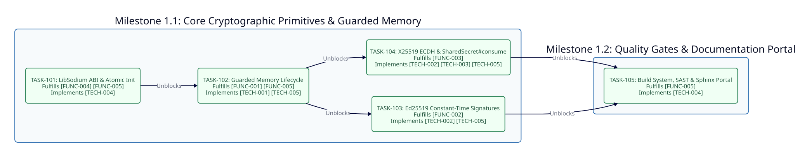

============
Phase 1: MVP
============

Timeline and Objectives
-----------------------

* **Target Release**: ``v0.2.1``
* **Status**: Completed
* **Objective**: Deliver constant-time Ed25519 digital signatures and X25519 ECDH key agreement backed by ``libsodium`` guarded memory, hardware page locks, reference-semantic key handles, ``Sync::Mutex`` FFI concurrency guards, and a zero-defect verification and documentation suite.

Phase 1 Dependency Graph
------------------------

Milestone 1.1: Core Cryptographic Primitives and Guarded Memory
---------------------------------------------------------------

* **TASK-101: LibSodium C ABI Bindings and Atomic Runtime Initialization**

  - **Status**: Completed (``[x]``)
  - **Fulfills**: ``[FUNC-004]``, ``[FUNC-005]``, ``[TECH-004]``
  - **Blocked By**: None
  - **Unblocks**: ``TASK-102``
  - **Scope**: Bind ``sodium_init``, ``sodium_library_version_major``, ``sodium_memcmp``, ``sodium_malloc``, ``sodium_free``, ``sodium_memzero``, and ``sodium_mprotect_*``. Implement thread-safe ``Sodium.init`` using ``Atomic(Bool)`` and ``Sync::Mutex`` with major version validation (``>= 10``) and constant-time slice comparison via ``Sodium.constant_time_equal?``.

* **TASK-102: Guarded Memory Lifecycle and Hardware Page Protection**

  - **Status**: Completed (``[x]``)
  - **Fulfills**: ``[FUNC-001]``, ``[FUNC-005]``, ``[TECH-001]``, ``[TECH-005]``
  - **Blocked By**: ``TASK-101``
  - **Unblocks**: ``TASK-103``, ``TASK-104``
  - **Scope**: Implement reference-semantic ``SecureBuffer`` and ``PrivateKeyPointer`` wrappers allocating inside ``sodium_malloc``, enforcing ``sodium_mprotect_readonly`` after initialization, synchronizing FFI pointer access via ``#with_pointer`` under ``Sync::Mutex``, and executing ``sodium_mprotect_readwrite`` + ``sodium_memzero`` + ``sodium_free`` on disposal.

* **TASK-103: Constant-Time Ed25519 Digital Signatures**

  - **Status**: Completed (``[x]``)
  - **Fulfills**: ``[FUNC-002]``, ``[TECH-002]``, ``[TECH-005]``
  - **Blocked By**: ``TASK-102``
  - **Unblocks**: ``TASK-105``
  - **Scope**: Implement ``Ed25519KeyPair.generate``, ``Ed25519KeyPair.from_seed``, ``Ed25519KeyPair#sign``, ``Ed25519KeyPair#verify``, ``Ed25519KeyPair.verify_detached``, and immutable ``PublicKey`` and ``Signature`` value structs with defensive byte copying.

* **TASK-104: Constant-Time X25519 ECDH Key Agreement and SharedSecret Auto-Disposal**

  - **Status**: Completed (``[x]``)
  - **Fulfills**: ``[FUNC-003]``, ``[TECH-002]``, ``[TECH-003]``, ``[TECH-005]``
  - **Blocked By**: ``TASK-102``
  - **Unblocks**: ``TASK-105``
  - **Scope**: Implement ``X25519KeyPair.generate``, ``X25519KeyPair.from_seed``, and ``X25519KeyPair#diffie_hellman`` and ``#shared_secret`` with small-order peer public key rejection and single-use ``SharedSecret#consume`` block-scoped auto-disposal.

Milestone 1.2: Quality Gates and Documentation Portal
-----------------------------------------------------

* **TASK-105: Build System, SAST Verification, and Sphinx Documentation Portal**

  - **Status**: Completed (``[x]``)
  - **Fulfills**: ``[FUNC-005]``, ``[TECH-004]``
  - **Blocked By**: ``TASK-103``, ``TASK-104``
  - **Unblocks**: Phase 2 (``TASK-201``)
  - **Scope**: Deliver the POSIX ``GNUmakefile``, multi-fiber concurrency and adversarial spec suite (25 specs passing), zero-suppression Ameba and Flaw SAST gates, and the full Sphinx and Crystal API documentation suite validated by ``crstlint`` and ``rstcheck``.

Critical Path
-------------

``TASK-103`` and ``TASK-104`` depend on ``TASK-102`` and execute in parallel before converging at ``TASK-105``:

``TASK-101 -> TASK-102 -> (TASK-103 || TASK-104) -> TASK-105``

All five tasks are complete and verified under ``v0.2.1`` with zero dependency violations.
