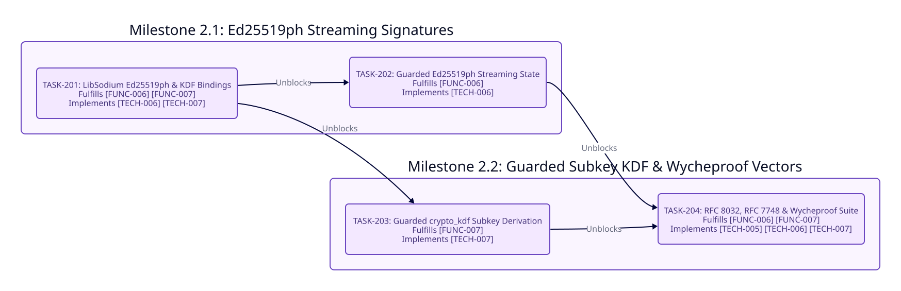

====================
Phase 2: Enhancement
====================

Timeline and Objectives
-----------------------

* **Target Release**: ``v0.3.0``
* **Status**: Planned
* **Objective**: Deliver RFC 8032 Section 5.1 pre-hashed ``Ed25519ph`` streaming signatures in guarded memory, BLAKE2b guarded subkey derivation via ``crypto_kdf_derive_from_key``, and automated RFC 8032, RFC 7748, and Project Wycheproof edge-case vector verification.

Phase 2 Dependency Graph
------------------------

Milestone 2.1: Ed25519ph Streaming Signatures
---------------------------------------------

* **TASK-201: LibSodium Ed25519ph and crypto_kdf C ABI Bindings**

  - **Status**: Planned (``[ ]``)
  - **Fulfills**: ``[FUNC-006]``, ``[FUNC-007]``, ``[TECH-006]``, ``[TECH-007]``
  - **Blocked By**: ``TASK-105`` (Phase 1 Completion)
  - **Unblocks**: ``TASK-202``, ``TASK-203``
  - **Scope**: Bind ``CryptoSignEd25519phState`` (208 bytes), ``crypto_sign_ed25519ph_init``, ``crypto_sign_ed25519ph_update``, ``crypto_sign_ed25519ph_final_create``, ``crypto_sign_ed25519ph_final_verify``, and ``crypto_kdf_derive_from_key`` inside ``LibSodium``.

* **TASK-202: Guarded Ed25519ph Streaming State Implementation**

  - **Status**: Planned (``[ ]``)
  - **Fulfills**: ``[FUNC-006]``, ``[TECH-006]``
  - **Blocked By**: ``TASK-201``
  - **Unblocks**: ``TASK-204``
  - **Scope**: Implement ``Ed25519PhStream`` allocating the 208-byte ``CryptoSignEd25519phState`` inside ``sodium_malloc`` guarded memory, toggling ``sodium_mprotect_readwrite`` and ``sodium_mprotect_readonly`` under ``@mutex.synchronize`` during ``#update``, and acquiring ``@mutex.synchronize`` in ``#final_sign`` and ``#final_verify`` to unlock the state page via ``sodium_mprotect_readwrite`` prior to invoking ``crypto_sign_ed25519ph_final_create`` or ``crypto_sign_ed25519ph_final_verify`` (because ``libsodium`` finalizes ``state->hs`` in place) before deterministically zeroing (``sodium_memzero``) and freeing (``sodium_free``) the state buffer inside an ``ensure`` block.

Milestone 2.2: Guarded Subkey KDF and Wycheproof Vectors
--------------------------------------------------------

* **TASK-203: Guarded crypto_kdf Subkey Derivation**

  - **Status**: Planned (``[ ]``)
  - **Fulfills**: ``[FUNC-007]``, ``[TECH-007]``
  - **Blocked By**: ``TASK-201``
  - **Unblocks**: ``TASK-204``
  - **Scope**: Implement ``Kdf.derive_subkey`` accepting a 32-byte guarded master key, 64-bit ``subkey_id``, and 8-byte ``context`` string, outputting 16-to-64-byte subkeys directly into read-only ``SecureBuffer`` guarded memory without touching the Crystal GC heap. Invalid ``master_key.size`` (``!= 32``), ``context.bytesize`` (``!= 8``), or ``subkey_size`` (``< 16`` or ``> 64``) raises ``ArgumentError``, while a disposed ``master_key`` or non-zero ``crypto_kdf_derive_from_key`` return code raises ``SodiumError``.

* **TASK-204: RFC 8032, RFC 7748, and Project Wycheproof Edge-Case Vector Suite**

  - **Status**: Planned (``[ ]``)
  - **Fulfills**: ``[FUNC-006]``, ``[FUNC-007]``, ``[TECH-005]``, ``[TECH-006]``, ``[TECH-007]``
  - **Blocked By**: ``TASK-202``, ``TASK-203``
  - **Unblocks**: ``v0.3.0`` Release Gate
  - **Scope**: Integrate automated test vector runners for RFC 8032 (``Ed25519`` and ``Ed25519ph``), RFC 7748 (``X25519``), and Project Wycheproof JSON fixtures verifying rejection of small-order Curve25519 points, non-canonical Edwards points, and malleable ``S >= L`` signature scalars.

Critical Path
-------------

``TASK-202`` and ``TASK-203`` both depend on ``TASK-201`` and execute in parallel before converging at ``TASK-204``:

``TASK-201 -> (TASK-202 || TASK-203) -> TASK-204``

Each task is scoped for a single deterministic TDD loop with zero forward dependency violations.
