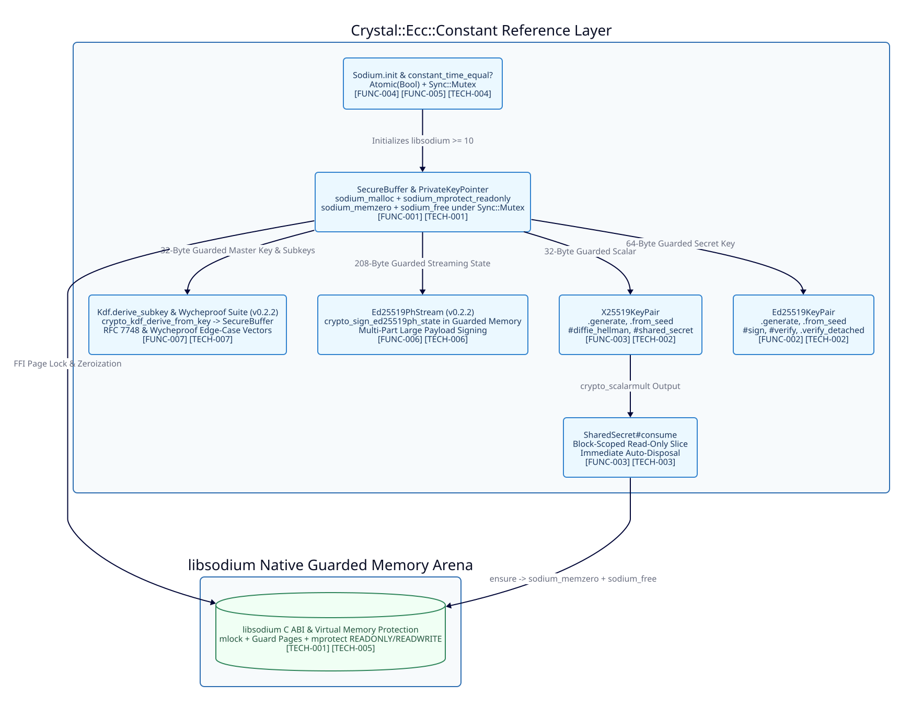

=====================
Architecture Overview
=====================

Requirement Mapping
-------------------

Fulfills ``[FUNC-001]``, ``[FUNC-002]``, ``[FUNC-003]``, ``[FUNC-004]``, ``[FUNC-005]``, ``[FUNC-006]``, ``[FUNC-007]`` (see :doc:`../../functional/specs/core-requirements`).

Architectural Diagram
---------------------

Introduction and Purpose
------------------------

``crystal-ecc-constant`` provides a constant-time Crystal wrapper for elliptic curve cryptography via ``libsodium``. Its primary purpose is to deliver Ed25519 digital signatures, pre-hashed ``Ed25519ph`` streaming signatures, X25519 Diffie-Hellman key agreement, and guarded subkey derivation while enforcing strict memory safety guarantees. Because Crystal's garbage collector scans managed heap memory, this shard isolates all sensitive cryptographic scalars and streaming states inside ``libsodium``'s guarded memory arena so the GC never scans, moves, or retains copies of private keys, shared secrets, or derived subkeys.

Library Layout and Namespaces
-----------------------------

The library source is organized under the ``Crystal::Ecc::Constant`` namespace:

* **``src/crystal-ecc-constant.cr``**: Shard entrypoint and semantic ``VERSION`` constant definition.
* **``src/crystal-ecc-constant/lib_sodium.cr``**: Low-level C ABI bindings (``LibSodium``) for initialization, Ed25519, ``Ed25519ph``, X25519, ``crypto_kdf``, constant-time comparison, and ``sodium_malloc`` page protection.
* **``src/crystal-ecc-constant/types.cr``**: ``SodiumError`` exception class and immutable ``PublicKey`` (32 bytes) and ``Signature`` (64 bytes) value structs with defensive copy accessors.
* **``src/crystal-ecc-constant/sodium.cr``**: ``Sodium`` struct providing thread-safe atomic initialization, runtime ``libsodium`` major version validation (``>= 10``), and ``constant_time_equal?``.
* **``src/crystal-ecc-constant/secure_memory.cr``**: ``SecureBuffer`` and ``PrivateKeyPointer`` alongside ``SharedSecret`` reference classes managing ``sodium_malloc`` allocations, ``sodium_mprotect_readonly`` hardware page locks, ``Sync::Mutex`` concurrency guards, and deterministic ``sodium_memzero`` disposal.
* **``src/crystal-ecc-constant/ed25519.cr``**: ``Ed25519KeyPair`` class supporting random generation, 32-byte seed derivation, detached signing, and constant-time verification.
* **``src/crystal-ecc-constant/x25519.cr``**: ``X25519KeyPair`` class supporting random generation, 32-byte seed derivation, and ECDH shared secret computation.

Technical Specifications
------------------------

* **[TECH-001] Guarded Memory Lifecycle for SecureBuffer and PrivateKeyPointer** (Fulfills ``[FUNC-001]``, ``[FUNC-005]``):
  All private keys, subkeys, and secret buffers are confined to ``libsodium``'s guarded memory arena via ``SecureBuffer`` and ``PrivateKeyPointer``. Allocation executes ``LibSodium.sodium_malloc``, which pins pages in physical memory with ``mlock`` and places canary and guard pages around the region. Immediately after population inside the initialization block, ``LibSodium.sodium_mprotect_readonly`` marks the memory pages read-only. If initialization raises an exception, the allocator immediately restores read-write permissions, zeroes the region via ``sodium_memzero``, and frees it via ``sodium_free``. All FFI access spans (``#with_pointer``) and disposal operations (``#dispose``) execute under ``Sync::Mutex`` to prevent time-of-check to time-of-use Use-After-Free race conditions across ``Fiber::ExecutionContext::Parallel`` threads. Wrapper types use heap-allocated ``class`` reference semantics rather than stack-allocated ``struct`` value semantics to prevent raw pointer duplication and double-free vulnerabilities.

* **[TECH-002] Constant-Time Ed25519KeyPair and X25519KeyPair Operations** (Fulfills ``[FUNC-002]``, ``[FUNC-003]``):
  ``Ed25519KeyPair`` manages a 32-byte ``PublicKey`` and a 64-byte guarded secret key, providing ``.generate`` (``crypto_sign_keypair``), ``.from_seed`` (``crypto_sign_seed_keypair``), ``#sign`` (``crypto_sign_detached``), ``#verify``, and ``.verify_detached`` and ``PublicKey#verify_ed25519`` (``crypto_sign_verify_detached``). ``X25519KeyPair`` manages a 32-byte ``PublicKey`` and a 32-byte guarded scalar, providing ``.generate`` (``crypto_box_keypair``), ``.from_seed`` (``crypto_box_seed_keypair``), and ``#diffie_hellman`` and ``#shared_secret`` (``crypto_scalarmult``). If ``crypto_scalarmult`` returns non-zero due to a small-order or all-zero peer public key, the allocated ``SharedSecret`` is immediately disposed before raising ``SodiumError``.

* **[TECH-003] Single-Use SharedSecret Consumption and Auto-Disposal** (Fulfills ``[FUNC-003]``):
  ``SharedSecret`` wraps a 32-byte ECDH output buffer in ``sodium_malloc`` guarded memory locked read-only via ``sodium_mprotect_readonly``. ``SharedSecret#consume(& : Bytes -> T)`` synchronizes under ``Sync::Mutex``, verifies that the secret has neither been consumed nor disposed, yields a read-only ``Bytes`` view to the caller's block, and deterministically unlocks, zeroes (``sodium_memzero``), and frees (``sodium_free``) the underlying guarded buffer inside an ``ensure`` block. The blockless overload ``SharedSecret#consume : Bytes`` copies the 32-byte secret into a fresh buffer and immediately wipes and frees the guarded arena allocation before returning.

* **[TECH-006] Ed25519ph Guarded Streaming State for v0.3.0** (Fulfills ``[FUNC-006]``):
  For Phase 2 (``v0.3.0``), ``Ed25519PhStream`` allocates the 208-byte ``LibSodium::CryptoSignEd25519phState`` (SHA-512 internal state) inside ``sodium_malloc`` guarded memory rather than on the Crystal GC heap. ``#initialize`` invokes ``crypto_sign_ed25519ph_init`` and locks the state read-only via ``sodium_mprotect_readonly``. Each call to ``#update(chunk : Bytes)`` synchronizes under ``@mutex.synchronize``, unlocks the state page via ``sodium_mprotect_readwrite``, invokes ``crypto_sign_ed25519ph_update``, and re-locks the page via ``sodium_mprotect_readonly``. Both ``#final_sign(keypair : Ed25519KeyPair)`` and ``#final_verify(public_key : PublicKey, signature : Signature)`` acquire ``@mutex.synchronize`` and unlock the guarded 208-byte ``CryptoSignEd25519phState`` page via ``sodium_mprotect_readwrite`` prior to invoking ``crypto_sign_ed25519ph_final_create`` or ``crypto_sign_ed25519ph_final_verify`` (because ``libsodium`` finalizes ``state->hs`` in place by writing padding and bit-length blocks into the state buffer), and deterministically zero (``sodium_memzero``) and free (``sodium_free``) the state buffer inside an ``ensure`` block.

* **[TECH-007] Guarded crypto_kdf Subkey Derivation and Wycheproof Test Harness for v0.3.0** (Fulfills ``[FUNC-007]``):
  For Phase 2 (``v0.3.0``), ``Kdf.derive_subkey(master_key : SecureBuffer, subkey_id : UInt64, context : String, subkey_size : Int32 = 32) : SecureBuffer`` validates parameters before allocation: an invalid ``master_key.size`` (``!= 32``), ``context.bytesize`` (``!= 8``), or ``subkey_size`` (``< 16`` or ``> 64``) raises ``ArgumentError``. It then allocates the target ``SecureBuffer`` in ``sodium_malloc`` guarded memory, invokes ``LibSodium.crypto_kdf_derive_from_key`` while holding ``master_key``'s mutex lock, and marks the derived subkey read-only via ``sodium_mprotect_readonly`` before returning; a disposed ``master_key`` or a non-zero ``crypto_kdf_derive_from_key`` return code immediately disposes any target buffer and raises ``SodiumError``. The automated verification harness parses and executes official RFC 8032, RFC 7748, and Project Wycheproof JSON test vectors to verify rejection of low-order X25519 points, non-canonical Ed25519 points, and malleable ``S >= L`` scalars.
